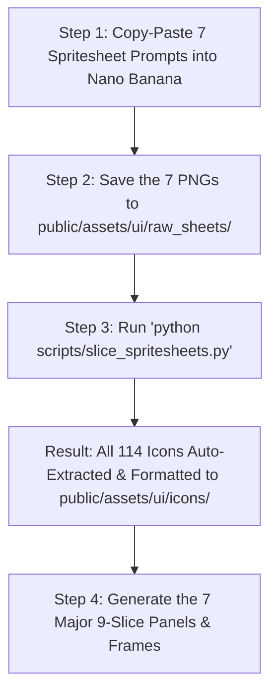

# BoatLoad — Master Spritesheet & Automated Slicing Specification
> **Architecture**: Consolidated Master Spritesheets + Auto-Slicer Pipeline  
> **Efficiency**: Reduced from **140 prompts down to just 14 prompts** (7 Spritesheets + 7 Master Frames).  
> **Automated Slicer Script**: [`scripts/slice_spritesheets.py`](file:///c:/Users/Father%20Fakir/Desktop/Textbooks/CGV/UI-Pixel/scripts/slice_spritesheets.py) (uses Python PIL to automatically slice, chroma-key, crop, and export all 114 icons directly into `public/assets/ui/icons/`).

---

## Automated Workflow Overview



### Dropping Raw Sheets (JPEGs or PNGs Supported)
Save your generated spritesheets (as `.jpg`, `.jpeg`, or `.png`) with these filenames into `public/assets/ui/raw_sheets/`:
1. `sheet_maritime.jpg` (or `.png`) — 16 Maritime & Ship Icons
2. `sheet_tools.jpg` (or `.png`) — 16 Tools, Construction & Cargo Icons
3. `sheet_combat.jpg` (or `.png`) — 16 Monsters, Combat & Hazard Icons
4. `sheet_weather.jpg` (or `.png`) — 16 Weather, Skies & Atmosphere Icons
5. `sheet_system.jpg` (or `.png`) — 16 UI Controls & Navigation Icons
6. `sheet_badges_biomes.jpg` (or `.png`) — 16 Badges, Biomes & Brush Icons
7. `sheet_brushes_materials.jpg` (or `.png`) — 16 Shipbuilding Materials & Health Sprites

### Automatic JPEG Transparency Conversion
Because Nano Banana generates JPEGs without alpha transparency, all prompts are tuned with a **solid pitch black `#000000` background**.
[`scripts/slice_spritesheets.py`](file:///c:/Users/Father%20Fakir/Desktop/Textbooks/CGV/UI-Pixel/scripts/slice_spritesheets.py) handles this automatically:
1. It uses perimeter flood-fill to carve away the black background and compression artifacts.
2. It protects any black/dark pixels *inside* the icons (eyes, cannons, cutlasses, hats).
3. It saves every sliced icon as a clean, transparent **`.png`** in `public/assets/ui/icons/`.

Then simply execute in your terminal:
```powershell
python scripts/slice_spritesheets.py
```
The script will auto-crop, key out any solid background color to true transparency, resize with nearest-neighbor pixel preservation, and save each icon under its exact name (e.g. `icon_anchor_24.png`, `icon_sloop_24.png`).

---

# Part 1: The 7 Master Spritesheet Prompts (Nano Banana Ready)

### [ ] Spritesheet Prompt #1 — Maritime, Ships & Navigation (4×4 Grid)
- **Target File**: `public/assets/ui/raw_sheets/sheet_maritime.png`
- **Output Icons**: 16 icons sliced into `public/assets/ui/icons/`
- **Grid Layout**:
  - `[0,0]` Heavy Anchor ⚓ | `[0,1]` Standard Sloop ⛵ | `[0,2]` War Frigate 🚢 | `[0,3]` Imperial Dreadnought 🏰
  - `[1,0]` Swift Skiff 🛶 | `[1,1]` Gag Truck 🛻 | `[1,2]` Captain's Helm Wheel ☸ | `[1,3]` Brass Pocket Compass 🧭
  - `[2,0]` Curling Wave 🌊 | `[2,1]` Island Atoll 🏝 | `[2,2]` Harbor Goal Buoy 🏁 | `[2,3]` Nautical Star ✦
  - `[3,0]` Magnifying Loupe 🔍 | `[3,1]` Treasure Map Chart 🗺 | `[3,2]` Waypoint Pennant 🏳 | `[3,3]` Fullscreen Brackets ⛶

```
16-bit pixel art maritime icons spritesheet, 4x4 evenly spaced grid of 16 distinct naval game icons on clean black background:
Row 1: heavy cast-iron naval anchor, wooden sloop sailing boat, 3-masted war frigate, colossal fortress galleon dreadnought
Row 2: wooden skiff rowboat with oars, rusty pickup truck in water, 8-spoke wooden steering wheel, antique brass pocket compass
Row 3: curling ocean wave with foam, sandy tropical island atoll with palm tree, checkered buoy flag, 4-point golden nautical star
Row 4: brass magnifying loupe glass, rolled treasure map chart, white waving pennant flag, brass fullscreen expanding corner brackets
Consistent 16-bit video game asset style, clean dark pixel outlines, vibrant DB32 nautical color palette, sharp grid separation --no text, blur, modern gradients
```

---

### [ ] Spritesheet Prompt #2 — Tools, Construction & Cargo (4×4 Grid)
- **Target File**: `public/assets/ui/raw_sheets/sheet_tools.png`
- **Output Icons**: 16 icons sliced into `public/assets/ui/icons/`
- **Grid Layout**:
  - `[0,0]` Claw Hammer 🔨 | `[0,1]` Sailmaker Needle 🪡 | `[0,2]` Rope Knot 🪢 | `[0,3]` Gold Spanish Doubloon 🪙
  - `[1,0]` Oak Timber Log 🪵 | `[1,1]` Iron-Banded Timber 🛡 | `[1,2]` Pine Lumber Plank 🌲 | `[1,3]` Tar Caulking Mallet 🧵
  - `[2,0]` Carving Adze Chisel 🧹 | `[2,1]` Divider Drafting Calipers 📐 | `[2,2]` Hand Mirror 🪞 | `[2,3]` Rotation Loop Arrow 🔄
  - `[3,0]` Miner Pickaxe ⛏ | `[3,1]` Wooden Cargo Crate 📦 | `[3,2]` Gunpowder Keg 🛢 | `[3,3]` Jagged Sea Reef Rock 🪨

```
16-bit pixel art shipbuilding and tools spritesheet, 4x4 evenly spaced grid of 16 distinct workshop icons on clean black background:
Row 1: forged iron claw hammer, curved brass sailmaker needle with hemp thread, coiled nautical rope knot, shiny gold spanish doubloon coin
Row 2: cross-section oak log with bark, dark iron-banded timber armor block, pale pine wood lumber plank, black tar caulking mallet with pitch roll
Row 3: shipwright carving adze chisel scraping shavings, brass divider drafting calipers, hand mirror showing symmetry line, circular rotation arrow around wood block
Row 4: iron mining pickaxe, wooden cargo shipping crate with iron straps, gunpowder barrel keg with burning fuse, sharp sea reef rock with green kelp
Consistent 16-bit video game asset style, crisp pixel cluster shading, DB32 palette, clean grid separation --no text, blur
```

---

### [ ] Spritesheet Prompt #3 — Combat, Monsters & Sea Hazards (4×4 Grid)
- **Target File**: `public/assets/ui/raw_sheets/sheet_combat.png`
- **Output Icons**: 16 icons sliced into `public/assets/ui/icons/`
- **Grid Layout**:
  - `[0,0]` Kraken Monster Head 🐙 | `[0,1]` Erupting Squid Tentacle 🦑 | `[0,2]` Shoal Siren 🧜 | `[0,3]` Crossed Cutlasses ⚔
  - `[1,0]` Barbed Boarding Harpoon 🔱 | `[1,1]` Swivel Deck Cannon 🔫 | `[1,2]` Muzzle Blast Flash 🔥 | `[1,3]` Detonation Burst 💥
  - `[2,0]` Target Crosshair Reticle 🎯 | `[2,1]` Wooden Bailer Bucket 🪣 | `[2,2]` Siren Musical Note ♫ | `[2,3]` Swirling Maelstrom 🌀
  - `[3,0]` Ghost Merchant Phantom 👻 | `[3,1]` Bull Kelp Weed 🌿 | `[3,2]` Defiant Pirate Fist 🖕 | `[3,3]` Briarwood Smoking Pipe 🚬

```
16-bit pixel art maritime combat and monster icons spritesheet, 4x4 evenly spaced grid of 16 distinct hazard icons on clean black background:
Row 1: terrifying red kraken monster head with yellow eyes, giant purple squid tentacle bursting from sea spray, mythical alluring shoal siren with teal scales, pair of crossed pirate cutlasses with golden guards
Row 2: barbed 3-prong naval harpoon spear with rope, bronze swivel deck cannon on pivot, fiery cannonball explosion muzzle flash, splintering detonation burst
Row 3: glowing cyan nautical crosshair target reticle, sloshing wooden bailer bucket full of seawater, glowing magenta siren musical note with sound waves, swirling ocean whirlpool maelstrom vortex
Row 4: cloaked ghost merchant phantom in green mist, strand of floating green bull kelp, sailor's tattooed fist raising single middle finger, carved briarwood smoking pipe with white smoke curl
Consistent 16-bit video game asset style, bold dark outlines, vibrant DB32 palette, clear grid separation --no text, blur
```

---

### [ ] Spritesheet Prompt #4 — Weather, Sky & Atmosphere (4×4 Grid)
- **Target File**: `public/assets/ui/raw_sheets/sheet_weather.png`
- **Output Icons**: 16 icons sliced into `public/assets/ui/icons/`
- **Grid Layout**:
  - `[0,0]` Radiant Fair Sun ☀ | `[0,1]` Dawn Horizon Sunrise 🌅 | `[0,2]` Dusk Golden Sunset 🌇 | `[0,3]` Silver Crescent Moon 🌙
  - `[1,0]` Rain Cloud Squall 🌧 | `[1,1]` Thunderhead Storm ⛈ | `[1,2]` Electric Lightning Arc ⚡ | `[1,3]` Sea Hurricane Vortex 🌪
  - `[2,0]` Dense Sea Fog Mist 🌫 | `[2,1]` Swirling Wind Gust 💨 | `[2,2]` Volumetric Sunbeams ✨ | `[2,3]` Brass Ship Bow Lantern 🏮
  - `[3,0]` Helmsman Binnacle Pedestal 🏛 | `[3,1]` Treasure Plunder Sack 🛍 | `[3,2]` Sailor Clapping Hands 👏 | `[3,3]` White Bunny Rabbit 🐰

```
16-bit pixel art weather and environmental icons spritesheet, 4x4 evenly spaced grid of 16 distinct sky and weather icons on clean black background:
Row 1: radiant golden sun with 8 flare rays, sunrise half-sun on pink horizon, golden hour sunset sinking below purple ocean, silver crescent moon with blue shadows
Row 2: dark gray rain cloud dropping diagonal blue rain, black thunderhead cloud with yellow lightning strike, sharp electric blue zigzag lightning arc, sea hurricane whirlwind vortex with spray
Row 3: horizontal layers of pale sea fog mist over water, swirling white and cyan gust of wind, diagonal golden sunbeams breaking through clouds, antique brass ship's lantern with glowing candle
Row 4: carved oak and marble ship's binnacle compass pedestal, tied burlap pirate treasure bag spilling gold coins, pair of sailor hands clapping in applause, white bunny rabbit in mid-hop
Consistent 16-bit video game asset style, crisp pixel cluster shading, clean grid separation --no text, blur
```

---

### [ ] Spritesheet Prompt #5 — UI Controls & Navigation (4×4 Grid)
- **Target File**: `public/assets/ui/raw_sheets/sheet_system.png`
- **Output Icons**: 16 icons sliced into `public/assets/ui/icons/`
- **Grid Layout**:
  - `[0,0]` Settings Bronze Cog ⚙ | `[0,1]` Closed Codex Book 📖 | `[0,2]` Rolled Sea Chart 📜 | `[0,3]` Film Slate Clapper 🎬
  - `[1,0]` Tripod Motion Camera 🎥 | `[1,1]` Celluloid Film Reel 🎞 | `[1,2]` CRT Display Monitor 🖥 | `[1,3]` Megaphone Horn 🔊
  - `[2,0]` Navy Floppy Disk 💾 | `[2,1]` Desktop In-Tray 📥 | `[2,2]` Arched Cabin Door 🚪 | `[2,3]` Leather Work Glove ✋
  - `[3,0]` Wicker Waste Basket 🗑 | `[3,1]` Vision Eye 👁 | `[3,2]` Feather Quill & Inkpot 🖋 | `[3,3]` Wooden Artist Palette 🎨

```
16-bit pixel art UI interface and system icons spritesheet, 4x4 evenly spaced grid of 16 distinct control icons on clean black background:
Row 1: 8-tooth mechanical bronze gear cogwheel, closed leather-bound logbook with brass clasp, rolled horizontal sea chart tied with ribbon, miniature wooden film clapperboard with zebra stripes
Row 2: vintage 35mm motion picture film camera on tripod, circular celluloid film reel with trailing negative, retro computer CRT monitor with scanlines, brass ship's acoustic speaking horn
Row 3: 3.5-inch navy blue floppy disk with label, wooden desktop in-tray with downward arrow, arched wooden ship cabin door with brass porthole, open sailor's leather work glove
Row 4: woven wicker scrap waste basket, open human eye with reflection highlight, antique goose feather quill pen dipped in inkpot, wooden kidney artist paint palette with colorful dab spots
Consistent 16-bit video game asset style, clean dark outlines, uniform metallic and wood tones, clear grid separation --no text, blur
```

---

### [ ] Spritesheet Prompt #6 — Badges, Biomes & Brush Chips (4×4 Grid)
- **Target File**: `public/assets/ui/raw_sheets/sheet_badges_biomes.png`
- **Output Icons**: 16 icons sliced into `public/assets/ui/icons/`
- **Grid Layout**:
  - `[0,0]` Green Checkmark ✅ | `[0,1]` Red Cross Mark ❌ | `[0,2]` Wooden Sticks X ✕ | `[0,3]` Heavy Brass Padlock 🔒
  - `[1,0]` Edison Light Bulb 💡 | `[1,1]` Brass Plus Sign ➕ | `[1,2]` Wooden Right Arrow ➔ | `[1,3]` Solid Play Triangle ▶
  - `[2,0]` Tropical Palm Chip 🌴 | `[2,1]` Volcanic Caldera Chip 🌋 | `[2,2]` Autumn Leaves Chip 🍂 | `[2,3]` Desert Butte Chip 🏜
  - `[3,0]` Nordic Snowflake Chip ❄ | `[3,1]` Circular Brush Ring ⭕ | `[3,2]` Square Fort Block ⬛ | `[3,3]` Captain Bust Portrait 🧑‍✈️

```
16-bit pixel art UI badges, biome chips and brush shapes spritesheet, 4x4 evenly spaced grid of 16 distinct icons on clean black background:
Row 1: bright green checkmark stamp with drop shadow, bold red cross cancel mark with beveled edges, crossed red wooden sticks forming an X mark, antique heavy brass padlock with iron shackle
Row 2: glowing yellow Edison glass lightbulb, chunky brass plus sign badge, chunky wooden directional arrow pointing right, solid triangular play button polygon
Row 3: square terrain biome chip with tropical palm tree and lagoon, volcanic obsidian mountain chip with glowing orange lava, autumn highlands chip with golden oak leaves, red rock desert canyon mesa butte chip
Row 4: crystalline hexagonal ice snowflake chip with blue highlights, circular white brush perimeter ring outline, solid white square fort block with beveled edges, 32-bit pixel art ship captain bust portrait in bicorne hat with gray beard
Consistent 16-bit video game asset style, clean dark outlines, clear grid separation --no text, blur
```

---

### [ ] Spritesheet Prompt #7 — 3D Brush Geometries & Damage Progression (4×4 Grid)
- **Target File**: `public/assets/ui/raw_sheets/sheet_brushes_materials.png`
- **Output Icons**: 16 sprites sliced into `public/assets/ui/hud/`
- **Grid Layout**:
  - `[0,0]` Single Voxel Cube | `[0,1]` Plank 1x3 | `[0,2]` Keel Beam 1x5 | `[0,3]` Slatted Deck Plate 2x2
  - `[1,0]` Bulkhead Wall 3x3 | `[1,1]` Sloop 100% HP (Upright) | `[1,2]` Sloop 75% HP (Slight Tilt) | `[1,3]` Sloop 40% HP (Heavy List)
  - `[2,0]` Sloop 10% HP (Capsized) | `[2,1]` Water Flood Wave Tile | `[2,2]` Floating Buoy Sprite | `[2,3]` Waterline Leak Drop
  - `[3,0]` Chronometer Needle | `[3,1]` Gold Coin Badge | `[3,2]` Pill Dot Divider | `[3,3]` Compass Wind Arrow

```
16-bit pixel art shipbuilding brushes and health status spritesheet, 4x4 evenly spaced grid of 16 sprites on clean black background:
Row 1: isometric 3D single wooden cube voxel block, elongated 1x3 timber plank block, long 1x5 structural keel beam, 2x2 slatted wooden deck grating tile
Row 2: 3x3 reinforced timber bulkhead wall with cross struts, side view wooden sloop floating perfectly upright 100% HP, side view sloop with minor cracked hull listing 15 degrees 75% HP, side view sloop with fractured hull listing 40 degrees 40% HP
Row 3: side view sloop fully capsized upside down in water 10% HP, seamless 32x32 sea water wave tile with white foam top, small red-and-white wooden buoy boat, glowing red water drop warning badge
Row 4: blackened steel clockwork chronometer indicator needle, shiny golden doubloon coin icon, brass decorative divider stud, ornate gold-and-blue fleur-de-lis wind direction compass arrow
Consistent 16-bit video game asset style, crisp pixel cluster shading, clean grid separation --no text, blur
```

---

# Part 2: The 7 Standalone Major UI Frames & Gauges

Generate these 7 major panels/bezels as individual assets:

### [ ] Standalone Prompt #8 — Main Menu Wooden Plaque (9-Slice)
- **Target File**: `public/assets/ui/frames/frame_main_menu_plaque.png`
- **Dimensions**: 256×256 px (9-slice scalable panel, 24px borders)
- **In-Game Use**: Title screen central wooden backing plate for logo & actions

```
16-bit pixel art UI window container, heavy pirate wooden plaque, weathered dark oak horizontal planks, carved beveled edges, ornate tarnished brass corner braces with round iron rivets, dark drop shadow, 9-slice scalable panel, 256x256 pixel grid, clean dark outlines, DB32 nautical palette (dark brown, brass gold, iron gray), on clean solid black background #000000 --no text, blur, modern gradients
```

---

### [ ] Standalone Prompt #9 — Captain's Logbook 2-Page Open Spread
- **Target File**: `public/assets/ui/frames/modal_logbook_spread.png`
- **Dimensions**: 640×440 px
- **In-Game Use**: Level selector open book frame with parchment pages & ribbon bookmark

```
32-bit pixel art open maritime logbook, top-down view, weathered leather book binding with brass corner protectors, open aged parchment two-page spread with deckle edges and subtle ink smudges, crimson satin ribbon bookmark draped across center spine, 640x440 resolution, clean pixel cluster shading, on clean solid black background #000000 --no text
```

---

### [ ] Standalone Prompt #10 — Pause Menu & Settings Cabinet (9-Slice)
- **Target File**: `public/assets/ui/frames/frame_pause_cabinet.png`
- **Dimensions**: 256×256 px (9-slice scalable panel, 20px borders)
- **In-Game Use**: In-game pause menu and graphics/audio settings modal window

```
16-bit pixel art UI window, nautical shipboard iron and dark mahogany cabinet, bolted brass trim, corner rivets, dark navy velvet interior backing, 9-slice tileable panel, 256x256 master tile, 16px borders, clean pixel outline, on clean solid black background #000000 --no text
```

---

### [ ] Standalone Prompt #11 — Ghost Merchant "Deadly Business" Driftwood Stall (9-Slice)
- **Target File**: `public/assets/ui/frames/frame_shop_ghost_stall.png`
- **Dimensions**: 320×320 px (9-slice scalable panel, 24px borders)
- **In-Game Use**: Island dock ghost merchant shopfront modal

```
32-bit pixel art UI shop modal, sunken pirate merchant stall, weathered waterlogged drift timbers, hanging seaweed, faint glowing green spectral ectoplasm aura along bottom rim, ornate iron lanterns, 9-slice resizable panel, 320x320 master tile, on clean solid black background #000000 --no text
```

---

### [ ] Standalone Prompt #12 — Port Royal Customs Manifest Results Ledger (9-Slice)
- **Target File**: `public/assets/ui/frames/frame_results_manifest.png`
- **Dimensions**: 440×520 px
- **In-Game Use**: Voyage accomplished summary ledger with notary gold seal

```
32-bit pixel art maritime customs manifest scroll, antique ledger paper with faint accounting grid lines, golden wax notary seal in lower corner, clipped edges, weathered warm tone, 440x520 resolution, on clean solid black background #000000 --no text
```

---

### [ ] Standalone Prompt #13 — Circular Porthole Gauge Frames (Brass & Verdigris)
- **Target File**: `public/assets/ui/hud/gauge_hp_porthole_64.png` & `gauge_water_porthole_64.png`
- **Dimensions**: 128×64 px (two 64×64 circular bezels side-by-side)
- **In-Game Use**: Top-left HUD Hull HP porthole and Water Level porthole frames

```
16-bit pixel art circular porthole gauge bezels spritesheet, two 64x64 circular gauge frames side-by-side on clean solid black background #000000:
Left bezel: polished brass porthole rim with 6 industrial iron hex bolts, inner beveled glass shadow rim, hollow circular center
Right bezel: oxidized verdigris green bronze porthole rim with copper rivets and water droplet condensation on glass, hollow circular center
Crisp metallic pixel shading, specular highlights, clean dark outlines, 128x64 image --no text
```

---

### [ ] Standalone Prompt #14 — Dark Souls Gothic Kraken Boss Bar Frame (9-Slice)
- **Target File**: `public/assets/ui/hud/boss_bar_kraken_gothic.png`
- **Dimensions**: 480×24 px (9-slice boss bar)
- **In-Game Use**: Bottom-screen Kraken health bar with barbed tentacle filigree

```
32-bit pixel art boss health bar frame, ornate gothic cast-iron metalwork, barbed kraken tentacle iron filigree brackets on left and right ends, carved stone border, hollow center track for health fill, 480x24 master sprite, dark brooding fantasy aesthetic, on clean solid black background #000000 --no text
```

---

## Slicing & Verification Guide

1. Generate the 7 spritesheets using prompts #1 through #7.
2. Place the 7 downloaded image files into `public/assets/ui/raw_sheets/`.
3. In PowerShell or Command Prompt, run:
   ```powershell
   python scripts/slice_spritesheets.py
   ```
4. All 114 icons will instantly appear in `public/assets/ui/icons/`, cropped and formatted with transparent backgrounds!
