# Currency Unification & Economy Architecture — Implementation Plan

> **Note**: This document outlines the technical specification and implementation plan for unifying the game's two disconnected currency systems into a single cohesive player economy. It supports customer repair contracts, shipyard construction profit margins, sailing voyage performance bonuses, obstacle damage penalties, persistent player debt (negative Doubloons), and Ghost Shop integration with extensible hooks for a future bargaining system.

---

## 1. Executive Summary & Problem Statement

### Current State (The Disconnect)
At present, two separate currencies and financial loops exist in the codebase:
1. **Player Wallet (`gameState.coins`)**:
   - Represents Doubloons used to purchase equipment (Wheels, Pedestals, Lanterns) from the Ghost Merchant stall (`src/ui/ShopUI.js`).
   - Earned through a flat voyage reward on the results screen (`src/ui/ResultsUI.js`).
   - Enforces a strict floor: `Math.max(0, ...)` and `spendCoins` rejects if `coins < amount`.
2. **Shipyard Repair Budget (`BudgetManager`)**:
   - An isolated temporary pool initialized with `levelCfg.budget` (`src/shipyard/BudgetManager.js`).
   - Displayed with dollar signs (`$`) in the shipyard top bar (`src/ui/BuildMenu.js`).
   - Completely discarded upon departing the drydock; leftover funds never reach the player's wallet.

### Target State (Unified Economy Loop)
The unified economy establishes an authentic merchant shipwright cycle:
1. **Customer Contract**: Customers bring their damaged vessel to port with an agreed repair budget specified in level data (`day*.json`), with an architecture ready for player bargaining.
2. **Shipyard Drydock**: Repairing the ship consumes funds from this budget. Crafting frugally leaves a profit margin.
3. **Voyage Delivery**: The player sails the vessel through hazardous waters. Avoiding obstacles secures the vessel's value; hitting rocks, reefs, or sinking incurs a damage penalty billed to the player.
4. **Voyage Settlement Ledger**: Leftover construction funds and voyage bonuses are credited, while incurred voyage damage is deducted. If damage exceeds earnings, the player's purse plunges into the **negatives (debt)**.
5. **Ghost Merchant & Progress**: The player's balance persists. Positive funds can be spent on mystical ship upgrades at the Ghost Shop, while debt locks purchases until the player works their way out with profitable repair runs.

---

## 2. Economy Flow Diagram

```mermaid
flowchart TD
    subgraph Dock ["1. Dock / Harbor"]
        A[Customer Contract Offered\nlevel-data budget: day1..day7] --> B[Future Bargaining Hook\nagreedBudget = baseBudget + bargainBonus]
    end

    subgraph Shipyard ["2. Drydock Shipyard"]
        B --> C[Inspect Hull & Breaches]
        C --> D[Repair Construction\nBlock cost = unitCost * count]
        D --> E[Track Repair Spending\nBudgetManager: spent vs agreedBudget]
    end

    subgraph Sailing ["3. Sailing Voyage Delivery"]
        E --> F[Cast Off: Capture Baseline Grid\n_sailSnapshot voxel integrity]
        F --> G[Navigate Obstacles & QTEs]
        G --> H{Voyage Outcome}
        H -->|Goal Reached| I[Safe Harbor Docking]
        H -->|Sunk / Timed Out| J[Shipwreck / Sunk Loss]
    end

    subgraph Ledger ["4. Financial Settlement"]
        I --> K[Calculate Voyage Ledger]
        J --> K
        K --> L[1. Leftover Construction Funds\nagreedBudget - repairSpent]
        K --> M[2. Sailing Rewards & Bonuses\n(Base Bounty + QTEs) * Pedestal Multiplier]
        K --> N[3. Incurred Voyage Damage\nDelta Voxels Lost * Rate + Sunk Penalty]
        L & M & N --> O[Net Day Payout = Leftover + Sailing - Damage]
    end

    subgraph Wallet ["5. Unified Wallet & Ghost Shop"]
        O --> P[Update Player Purse\nthis.coins += Net Payout]
        P --> Q{Purse Balance}
        Q -->|Positive >= Cost| R[Ghost Shop Stall Unlocked\nCan buy Wheels, Pedestals, Lanterns]
        Q -->|< 0 Negative Debt| S[Purse In Debt\nShop Locked, Must Repair Next Day to Repay]
    end
```

---

## 3. Mathematical Formula & Settlement Specifications

### 3.1. Contract Budget & Bargaining
$$\text{ContractBudget} = \text{BaseBudget}_{\text{level-data}} + \text{BargainBonus}$$
* Currently, `BargainBonus = 0` until the bargaining minigame/dialogue system is activated.

### 3.2. Shipyard Construction Margin & Over-Budget Warning
$$\text{LeftoverConstructionProfit} = \text{ContractBudget} - \text{RepairExpenditure}$$
* If player stays under budget: $\text{LeftoverConstructionProfit} > 0$ (player profit).
* If player exceeds budget (supplementing repairs): $\text{LeftoverConstructionProfit} < 0$ (comes out of player pocket).
* **Over-Budget Warning**: The moment repair expenditures exceed the customer's allocated budget, the system triggers a warning notification (`⚠️ OVER BUDGET: You have exceeded the customer's allocated budget! Extra repairs will be paid from your own purse.`) and the shipyard HUD highlights the deficit in crimson.

### 3.3. Sailing Rewards
$$\text{SailingReward} = (\text{BaseVoyageBounty} + \text{QTEBonusDoubloons}) \times \text{PedestalMultiplier}$$
* $\text{BaseVoyageBounty} = 150 + \text{day} \times 75$
* $\text{PedestalMultiplier} = 1.0\text{x} \dots 1.6\text{x}$ (derived from equipped pedestal in `src/config/ShopRegistry.js`).

### 3.4. Voyage Incurred Damage Penalty & Sinking Reset
$$\Delta\text{DamagedVoxels} = \max(0, \text{IntactVoxels}_{\text{start}} - \text{IntactVoxels}_{\text{end}})$$

$$\text{VoyageDamageCost} = \Delta\text{DamagedVoxels} \times \text{DamageRate}$$

* **$\text{DamageRate}$**: 8 Doubloons per damaged/destroyed voxel incurred during passage delivery.
* **Sinking Reset (No Salvage Fee)**: If the ship sinks during the voyage (`playerSunk` / `voyageLost`), **no salvage penalty is charged**. The ship and shipyard cleanly reset to the initial level state with the original customer budget, as if the player had not sailed at all.

### 3.5. Net Daily Payout & Purse Update
$$\text{NetPayout} = \text{LeftoverConstructionProfit} + \text{SailingReward} - \text{VoyageDamageCost}$$

$$\text{Purse}_{\text{new}} = \text{Purse}_{\text{previous}} + \text{NetPayout}$$

> **Important**: On completed voyages, $\text{Purse}_{\text{new}}$ is explicitly allowed to be negative if damage incurred on the voyage exceeds earnings (e.g. $+80$ leftover profit $+ 200$ voyage reward $- 400$ collision damage $= -120$ net payout), plunging the wallet into debt. If the ship sinks, the run resets with original budget as if never sailed.

---

## 4. Debt & Negative Balance Mechanics

| State | Player Purse Balance | Shipyard Drydock Access | Ghost Shop Access | Level Progression |
| :--- | :--- | :--- | :--- | :--- |
| **Solvent** | $\ge 0$ Doubloons | Full access; customer funds drydock repairs. | Full access; can purchase and equip items. | Advance to next day. |
| **In Debt** | $< 0$ Doubloons | Full access; **customer still funds the repair budget** for their own vessel. | **LOCKED**. Displays negative crimson balance and "Cannot trade while indebted to the port". | Advance to next day to earn way out of debt. |

### How Debt Avoids Soft-Locks
Because customers bring their own repair budget for their ship, an indebted player is never prevented from repairing a vessel. By repairing carefully with cheap timber (Pine/Oak) and steering clear of hazards, an indebted player earns large profit margins to restore positive credit.

---

## 5. Architectural Hooks for the Future Bargaining System

To make the subsequent bargaining implementation a zero-friction drop-in:
1. **Contract State in `GameState`**:
   ```javascript
   this.currentContract = {
     day: 1,
     baseBudget: 200,      // from dayX.json
     bargainBonus: 0,      // negotiated increase
     agreedBudget: 200,    // baseBudget + bargainBonus
     status: 'offered'     // 'offered' | 'bargained' | 'active' | 'settled'
   };
   ```
2. **Event Bus Protocol**:
   - `emit('contractOffered', { day, baseBudget })`
   - `emit('contractBargainSuccess', { bonusAdded })` $\rightarrow$ increases `bargainBonus` and `agreedBudget`.
   - `emit('contractFinalized', { agreedBudget })`
3. **UI Anchor in `LevelSelectorUI`**:
   The customer dossier will include an action button or container `#dossier-bargain-container` ready to trigger the bargaining interaction when implemented.

---

## 6. Technical Specifications & File Modifications

### 6.1. `src/core/GameState.js`
* **Negative Coins Support**:
  - Update `addCoins(amount)` to allow settling negative delta amounts.
  - Update `spendCoins(amount)`: reject if `this.coins < amount` or `this.coins <= 0`.
  - Update `_saveEconomy()` / `_loadEconomy()`: ensure signed integers persist correctly.
* **Contract Management**:
  - Track `this.currentContract`.
  - When loading level data, initialize `this.currentContract` with `levelCfg.budget`.
* **Shipyard Lifecycle Integration**:
  - In `_enterShipyard()`: Pass `currentContract.agreedBudget` to `BudgetManager`.
  - In `_exitShipyard()`: Store `this.currentContract.spentOnRepairs = this._budgetManager.spent`.
* **Voyage Damage Diff Calculation**:
  - In `_enterObstacle()`: Record `this._sailInitialIntactCount = DamageSystem.getSummary(this._grid).intact`.
  - In `_enterResults()` / `voyageLost`:
    - Compute `finalIntact = DamageSystem.getSummary(this._grid).intact`.
    - Compute `damageDiff = Math.max(0, this._sailInitialIntactCount - finalIntact)`.
    - Assemble complete ledger breakdown payload and emit to `ResultsUI`.
    - Apply `netPayout` to `this.coins`.

### 6.2. `src/shipyard/BudgetManager.js`
* Replace internal dollar terminology with Doubloons.
* Add properties:
  - `this.contractBudget = initialBudget;`
  - `this.spent = 0;`
  - `get leftoverProfit()`: `this.contractBudget - this.spent`
* Ensure `emit('budgetChanged')` delivers `{ total, spent, remaining, leftoverProfit }`.

### 6.3. `src/ui/BuildMenu.js` & `src/ui/ui.css`
* Replace `$` formatting in `.hud-budget-box` with `<span class="pixel-icon icon-doubloon size-14"></span>`.
* Display:
  - **Contract Budget**: `200 Doubloons`
  - **Materials Cost**: `Spent: 125 Doubloons`
  - **Est. Profit Margin**: `Profit: +75 Doubloons` (gold when positive, red if exceeding budget).
* Update material tiles to show unit cost with Doubloons icon.

### 6.4. `src/ui/ResultsUI.js` (The Voyage Settlement Ledger)
* Redesign the modal to display the unified financial breakdown:
  1. **Shipwright Repair Contract**:
     - Customer Agreed Budget: `+200 Doubloons`
     - Materials Consumed: `-125 Doubloons`
     - Construction Margin: `+75 Doubloons`
  2. **Passage Bounty**:
     - Base Passage Fee: `+225 Doubloons`
     - Pedestal Bonus: `+56 Doubloons`
  3. **Incurred Voyage Damage**:
     - Hull Breaches & Collisions: `-80 Doubloons` (calculated from damaged voxel delta @ 8 Doubloons/voxel).
  4. **Summary & Purse**:
     - Net Daily Settlement: `+276 Doubloons` (or negative in crimson).
     - Total Purse Balance: `${this.gameState.coins} Doubloons` (with `(IN DEBT)` badge if negative).
* **Sinking Reset**: If the vessel sinks during the voyage, no salvage fee is charged; the vessel and customer contract cleanly reset to original budget as if the player had never sailed.

### 6.5. `src/ui/ShopUI.js` (Ghost Shop "Deadly Business")
* Support negative purse balance:
  - If `coins < 0`, display `<span class="shop-wallet-coins debt">-${Math.abs(coins)}</span>` with `(In Debt)` label.
  - Disable purchase buttons with a notice: *"The dead trade only with solvent sailors."*

### 6.6. `src/ui/LevelSelectorUI.js`
* Ensure the dossier reads the level's `budget` field dynamically.
* Add a placeholder dispatch element ready for bargaining integration:
  `[Bargain for Higher Budget (Coming Soon)]`.

---

## 7. Phased Implementation Roadmap

```mermaid
gantt
    title Currency Unification Implementation
    dateFormat  X
    axisFormat %d
    section Phase 1: Core State
    GameState economy & negative coins     :p1, 0, 1
    Contract lifecycle & damage diff       :p2, 1, 2
    section Phase 2: Shipyard Unification
    BudgetManager Doubloons conversion     :p3, 2, 3
    BuildMenu HUD & profit margin counter  :p4, 3, 4
    section Phase 3: Results Ledger
    ResultsUI 4-tier settlement redesign   :p5, 4, 5
    Wreck / Sinking ledger integration     :p6, 5, 6
    section Phase 4: Shop & UI Polish
    ShopUI debt handling & styling         :p7, 6, 7
    LevelSelectorUI contract alignment     :p8, 7, 8
    section Phase 5: Testing
    End-to-end verification & balancing    :p9, 8, 9
```



1. **Phase 1: GameState & Contract Core**
   - Refactor `GameState.js` to manage contracts, allow negative balances, diff grid voxel damage, and settle net payouts.
2. **Phase 2: Shipyard & BudgetManager Doubloons Conversion**
   - Update `BudgetManager.js` and `BuildMenu.js` to Doubloons currency and live profit-margin display.
3. **Phase 3: ResultsUI Voyage Settlement Ledger**
   - Overhaul `ResultsUI.js` to render the 4-tier financial breakdown and handle both safe arrival and shipwreck outcomes.
4. **Phase 4: Ghost Shop Debt Safeguards & Styling**
   - Add negative balance feedback, crimson styling, and purchase prevention in `ShopUI.js`.
5. **Phase 5: Level Selector Dossier Alignment**
   - Sync all level dossier displays with `day*.json` budget data and prepare the bargaining hook.
6. **Phase 6: Verification & Balancing**
   - Test safe run (positive profit), rough collision run (diminished payout), and sinking run (debt incurred).

---

## 8. Verification & Acceptance Criteria

- [ ] **Contract Budgeting**: Entering Shipyard initializes budget from selected level's `budget` property.
- [ ] **Real-time Profit Display**: Shipyard HUD updates profit margin in Doubloons as voxels are placed and erased.
- [ ] **Session Refunds**: Undoing/erasing repair blocks accurately refunds materials; dismantling original hull blocks awards zero refund.
- [ ] **Voxel Damage Diff**: Obstacle collisions during sailing reduce voxel count and are calculated accurately in Doubloon penalties.
- [ ] **Complete Settlement Breakdown**: `ResultsUI` cleanly displays Customer Budget, Material Spent, Sailing Bounty, and Damage Incurred.
- [ ] **Negative Wallet & Debt**: Excessive damage or sinking successfully plunges wallet into the negatives.
- [ ] **Ghost Shop Response**: When in debt, Ghost Shop clearly displays negative balance in crimson and blocks purchasing.
- [ ] **No Soft-Locks**: An indebted player can still accept contracts, repair ships with customer funds, and sail to earn profit.
- [ ] **Persistence**: Negative balances and inventory persist accurately in `localStorage ('boatload_economy')`.
