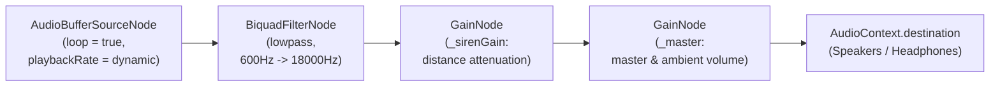

# Dynamic Mermaid Call Audio Implementation Plan

## 1. Executive Summary & Objective

The current siren encounter in BoatLoad utilizes a synthetic procedural dual-sawtooth oscillator drone (`_sirenOsc` / `_sirenOsc2` in `src/utils/AudioManager.js`). While functionally connected to the steering torque pull, it lacks the visceral, haunting atmosphere of a true mythological siren/mermaid.

This plan outlines the complete replacement of the procedural siren drone with the authored audio sample **`Mermaid_call.mp3`** located at `c:\Users\yami2\Third Year stuff\Computer Graphics and Visualisation\Mermaid_call.mp3`. 

The new audio system will implement:
1. **Distance-Based Attenuation:** The call begins softly as the player enters the outer attraction boundary and swells dramatically in presence, volume, and clarity as the ship draws nearer to the siren/reef.
2. **Infinite Seamless Looping with Clean Escape:** The sample loops continuously as long as the player is within the siren's audible zone—even if the player successfully blocks off the steering pull via QTE resistance. It terminates only when the player's boat physically escapes the range of audibility.
3. **Dynamic Motion Modulation (Pitch, Speed & Timbre):** The playback rate, pitch, and acoustic filtering dynamically adapt to the physical movement of the vessel:
   - **Forward Speed & Approach Vector:** Sailing faster toward the mermaid introduces an acoustic Doppler shift and heightened urgency (speed/pitch increase); fleeing or decelerating relaxes the pitch.
   - **Helm Strain & Yaw Velocity:** Counter-steering against the siren's hypnotic steering pull introduces an eerie, undulating pitch flutter reflecting the mental fight and physical helm resistance.
   - **Proximity Filtering:** Low-pass filtering muffles distant singing through fog and waves, gradually opening up to bright, crystal-clear vocal frequencies close to the rocks.
4. **Zero Overlap / Safe Concurrency:** Strict change isolation to avoid interference with concurrent work on the QTE stations, harpoon animations, or ship mechanics.

---

## 2. Asset Pipeline & Placement

### 2.1 Asset Source & Target Paths
- **Source:** `c:\Users\yami2\Third Year stuff\Computer Graphics and Visualisation\Mermaid_call.mp3` (~1.5 MB, MP3 audio)
- **Runtime Target:** `BoatLoad/public/assets/audio/mermaid_call.mp3`
- **Source Target:** `BoatLoad/src/assets/audio/mermaid_call.mp3` (for asset tracking and build consistency)

### 2.2 Ingestion & Caching Strategy
- Vite serves files placed in `public/assets/audio/` directly under `getAssetUrl('assets/audio/mermaid_call.mp3')`.
- `AudioManager._loadSirenBuffer()` asynchronously fetches and decodes the audio into a native Web Audio `AudioBuffer` upon the first user interaction gesture or game start.
- The decoded `AudioBuffer` remains resident in memory (`this._sirenBuffer`), eliminating any disk I/O latency or hitching during gameplay.

---

## 3. Web Audio Architecture (`src/utils/AudioManager.js`)

### 3.1 Audio Node Graph


### 3.2 Dynamic Parameter Mapping

| Audio Parameter | Controlling Metric | Target Formula / Curve | Acoustic Effect |
|---|---|---|---|
| **Volume (Gain)** | Distance $d$ to nearest siren vs $R_{attract}$ | $k = \text{clamp}(1 - d / R, 0, 1)$<br>$\text{gain} = (0.05 + 0.95 \cdot k^{1.4}) \cdot \text{vol}_{ambient}$ | Barely audible siren whisper at the perimeter; swells into an overwhelming, hypnotic call up close. |
| **Speed & Pitch** | Boat speed $v$ & approach vector $\vec{v} \cdot \hat{d}$ | $\text{rate}_{base} = 1.0$<br>$\Delta\text{rate}_{speed} = \text{clamp}(v / 15.0, 0, 1.5) \cdot 0.06$<br>$\Delta\text{rate}_{doppler} = \text{clamp}(\vec{v}_{dir} \cdot \hat{d}_{siren}, -1, 1) \cdot 0.04$ | Approaching at high speed compresses the vocal pitch slightly higher (+5-10%); turning away eases it down. |
| **Pitch Flutter (Yaw / Helm)** | Angular turn rate $|\omega_{yaw}|$ | $\Delta\text{rate}_{yaw} = \text{clamp}(|\omega_{yaw}| / 2.0, 0, 1) \cdot 0.035 \cdot \sin(8\pi t)$ | Fighting the helm creates subtle hypnotic warble/dissonance. |
| **Lowpass Filter Cutoff** | Proximity factor $k$ & speed | $f_{cutoff} = 700\text{ Hz} + 17300\text{ Hz} \cdot k^{1.2}$ | Damped, muffled call across ocean distance; crisp, intimate vocal clarity upon approach. |

### 3.3 Loop & Escape Lifecycle
1. **Zone Entry ($d < R_{attract}$ and $\text{resistant} == \text{false}$):**
   - If not already playing, allocate `AudioBufferSourceNode` using `this._sirenBuffer`.
   - Set `source.loop = true`.
   - Connect through filter and gain nodes.
   - Smoothly ramp gain from $0$ to target over `0.25s` to avoid sudden pop.
2. **Sustained Presence ($d < R_{attract}$):**
   - Continuously update `gain.setTargetAtTime`, `playbackRate.setTargetAtTime`, and `filter.frequency.setTargetAtTime` per incoming telemetry from `SirenManager`.
   - The loop continues seamlessly regardless of duration.
3. **Escape / Resolution ($d \ge R_{attract}$, or QTE success / resistance active, or ship sunk / phase changed):**
   - Set gain target to `0` with a smooth exponential fade-out over `0.5s–0.8s`.
   - Schedule `source.stop(t + 0.8)` and clean up references once silent.
   - Safety watchdog: If no `sirenPulling` updates arrive for >350ms, the audio automatically initiates a fade-out to prevent stuck audio.

---

## 4. Telemetry & Manager Integration (`src/monsters/SirenManager.js`)

### 4.1 Telemetry Emission
`SirenManager.js` already runs a per-frame update loop calculating distance to all active sirens and evaluating steering pull torques.

We will enrich the `sirenPulling` event payload:
```javascript
// Calculate dynamic boat movement metrics
const shipForward = new THREE.Vector3(0, 0, -1).applyQuaternion(playerShip.mesh.quaternion).normalize();
const toSiren = new THREE.Vector3(closestDx, 0, closestDz).normalize();
const approachDot = shipForward.dot(toSiren); // 1 = directly toward siren, -1 = directly away

const boatSpeed = playerShip.speedMultiplier * (playerShip._isHalted ? 0 : 15.0 * (playerShip.throttle ?? 1.0));
const yawVelocity = playerShip.yawVelocity || 0;

emit('sirenPulling', {
  intensity: maxIntensityThisFrame,
  steerPull: netSteerPullThisFrame,
  dist: minActiveDist,
  radius: activeAttractRadius,
  boatSpeed: boatSpeed,
  yawVelocity: yawVelocity,
  approachDot: approachDot,
});
```

### 4.2 Escape Detection
When all sirens are either:
- Outside `attractRadius` ($d \ge R_{attract}$), OR
- In active resistance cooldown (`siren.resistanceRemaining > 0`),
`SirenManager` will emit `{ intensity: 0, steerPull: 0, escaped: true }` and signal `AudioManager` to initiate a smooth fade-out.

---

## 5. Concurrency & Overlap Safeguards

To respect other active agent tasks in the workspace:
1. **Unmodified Files:**
   - Do **NOT** modify `src/obstacle/PlayerShip.js`.
   - Do **NOT** modify `src/ui/HUD.js` (HUD safely consumes `d.steerPull` and `d.intensity` ignoring extra payload fields).
   - Do **NOT** modify `src/environment/EnvironmentManager.js` or `ParticleSystem.js`.
   - Do **NOT** touch any existing QTE or Harpoon test files.
2. **Modified Files (Scoped strictly to Mermaid Audio):**
   - `BoatLoad/src/utils/AudioManager.js` (replace procedural drone with audio buffer mermaid call engine).
   - `BoatLoad/src/monsters/SirenManager.js` (add telemetry fields to the existing `sirenPulling` emit in `update()`).
   - `BoatLoad/public/assets/audio/mermaid_call.mp3` & `BoatLoad/src/assets/audio/mermaid_call.mp3` (new binary assets).
   - `BoatLoad/tests/siren-mermaid-audio.test.js` (new standalone test suite).

---

## 6. Implementation Steps & Verification

### Step 1: Asset Ingestion
- Copy `c:\Users\yami2\Third Year stuff\Computer Graphics and Visualisation\Mermaid_call.mp3` to `BoatLoad/public/assets/audio/mermaid_call.mp3` and `BoatLoad/src/assets/audio/mermaid_call.mp3`.

### Step 2: Telemetry Enhancement in `SirenManager.js`
- Compute `minActiveDist`, `activeAttractRadius`, `boatSpeed`, `yawVelocity`, and `approachDot` during `update(delta, playerShip)`.
- Pass these fields inside `emit('sirenPulling', ...)`.

### Step 3: Mermaid Call Engine in `AudioManager.js`
- Implement buffer loading for `mermaid_call.mp3`.
- Build the `AudioBufferSourceNode (loop=true)` + `BiquadFilterNode` + `GainNode` pipeline.
- Implement dynamic modulation for volume, pitch/playbackRate, and filter frequency based on boat motion.
- Implement graceful fade-out on escape, level change, or pause.

### Step 4: Standalone Unit Testing
- Create `BoatLoad/tests/siren-mermaid-audio.test.js` testing:
  - Calculation and emission of distance, radius, approach vector, and yaw velocity.
  - Correct looping and volume/pitch scaling functions.
  - Fade-out trigger when player escapes attraction radius or activates resistance.
- Run `node --test tests/siren-manager.test.js` and `node --test tests/siren-mermaid-audio.test.js`.

