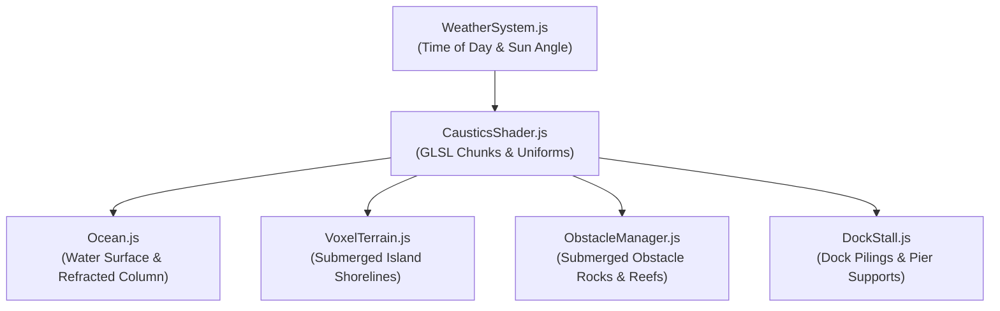

# Implementation Plan: Animated Underwater Caustics Shader

**Target Feature:** Option 5 — Animated Underwater Caustics Shader  
**Course Relevance:** Slide 6 (Fragment Mathematics & Lighting) and Slide 7 (Procedural Texturing & Trigonometric Interference Patterns)  
**Target Repository:** `BoatLoad`

---

## 1. Executive Summary & Visual Goal

### 1.1 What It Does
In real-world bodies of water, sunlight refracting through undulating surface waves focuses into bright, shifting geometric ribbons and web-like networks of light called **caustics**.

This implementation brings procedural, real-time animated caustics to *BoatLoad*. As sunlight penetrates the ocean surface:
1. **Translucent Water Volume**: Looking down through the water surface reveals shifting, organic web patterns of focused light within the water column.
2. **Submerged Geometry**: Any geometry submerged beneath water level ($y < 0$), including the seabed, voxel island shores, submerged obstacle rocks/reefs, dock pilings, and ship hull bottoms, receives animated caustic illumination.
3. **Depth Attenuation (Beer-Lambert Law)**: Light rays attenuate exponentially with water depth; shallow water exhibits bright, high-contrast caustics, while deep water smoothly fades into ambient ocean blues.
4. **Chromatic Dispersion**: A subtle RGB phase offset splits the caustic lines into faint rainbow fringes (red, green, and blue refracting at slightly different indices).
5. **Weather & Sunlight Integration**: Caustic brightness dynamically responds to `timeOfDay` and storms (brightest at midday sunny weather, dimming under twilight/moonlight, and diffusing under stormy skies).

---

## 2. Mathematical Foundation & GLSL Algorithm

### 2.1 Wave Interference Function (Slide 7: Procedural Texturing)
Instead of sampling static textures, the caustic pattern is computed procedurally using multi-scale trigonometric wave interference:

$$\text{Caustic}(\mathbf{P}, t) = \left(\text{smoothstep}\left(0.1, 1.6, C_1 + C_2 + C_3\right)\right)^{2.4}$$

Where:
* $\mathbf{P} = (x, z)$ represents world-space coordinates.
* $C_1 = \sin(P_x \cdot 1.8 + t \cdot 1.2) + \cos(P_z \cdot 1.8 + t \cdot 1.0)$ (Primary directional swell)
* $C_2 = \sin(P_x \cdot 2.6 - t \cdot 0.8) + \cos(P_z \cdot 2.6 + t \cdot 1.1)$ (Counter-propagating wave)
* $C_3 = \sin((P_x + P_z) \cdot 3.8 + t \cdot 1.6) \cdot 0.5$ (High-frequency capillary ripple)

### 2.2 Chromatic Dispersion (Prismatic Fringing)
By introducing a slight spatial/phase offset for each color channel ($\Delta\mathbf{u}$), we simulate physical wavelength dispersion:

$$\mathbf{C}_{\text{caustic}} = \begin{pmatrix} \text{Caustic}(\mathbf{P} - \Delta\mathbf{u}, t) \\ \text{Caustic}(\mathbf{P}, t) \\ \text{Caustic}(\mathbf{P} + \Delta\mathbf{u}, t) \end{pmatrix}$$

### 2.3 Depth Attenuation (Beer-Lambert Law)
Light intensity diminishes exponentially through an absorbing medium:

$$I(\text{depth}) = I_0 \cdot \exp(-\alpha \cdot \text{depth}) = I_0 \cdot \exp(-\alpha \cdot \max(0.0, y_{\text{surface}} - y_{\text{fragment}}))$$

* In shallow water ($\text{depth} < 1.5\,\text{m}$), caustics are crisp and intense.
* Beyond $6.0\,\text{m}$ depth, caustics smoothly fade to zero, matching the deep ocean color.

---

## 3. Architecture & File Breakdown



### Files Created or Modified

1. **`src/environment/CausticsShader.js` (NEW)**
   * Centralizes the caustic GLSL functions, uniform definitions, and helper binders to keep shader code DRY and maintainable across materials.
2. **`src/environment/Ocean.js` (MODIFIED)**
   * Injects caustic interference into the transparent water surface shader so the water itself visibly refracts light.
3. **`src/editor/VoxelTerrain.js` (MODIFIED)**
   * Injects the caustic GLSL chunk into `VoxelTerrain.material.onBeforeCompile` for all voxels where $vWorldPos.y < 0.2$.
4. **`src/obstacle/ObstacleManager.js` (MODIFIED)**
   * Enhances obstacle rock materials via `onBeforeCompile` to project caustics onto submerged rock surfaces.
5. **`src/environment/DockStall.js` (MODIFIED)**
   * Injects caustics onto the underwater portions of wooden dock pilings and foundation beams.

---

## 4. Detailed Implementation Steps

### Step 1: Create `src/environment/CausticsShader.js`
Create a dedicated utility module containing the shader uniforms and reusable GLSL code.

```javascript
import * as THREE from 'three';

export const CausticUniforms = {
  uCausticTime: { value: 0 },
  uCausticIntensity: { value: 0.85 },
  uCausticScale: { value: 0.35 },
  uCausticSpeed: { value: 1.0 },
  uWaterLevel: { value: -0.5 },
  uSunDir: { value: new THREE.Vector3(10, 20, 10).normalize() },
  uCausticColor: { value: new THREE.Color(0xb2f5ea) } // Pale turquoise sunlight
};

export const CausticGLSL = /* glsl */ `
  uniform float uCausticTime;
  uniform float uCausticIntensity;
  uniform float uCausticScale;
  uniform float uCausticSpeed;
  uniform float uWaterLevel;
  uniform vec3 uSunDir;
  uniform vec3 uCausticColor;

  float sampleCausticPattern(vec2 pos, float t) {
    vec2 p = pos * uCausticScale;
    float c1 = sin(p.x * 1.8 + t * 1.2) + cos(p.y * 1.8 + t * 1.0);
    float c2 = sin(p.x * 2.6 - t * 0.8) + cos(p.y * 2.6 + t * 1.1);
    float c3 = sin((p.x + p.y) * 3.8 + t * 1.6) * 0.5;
    return pow(smoothstep(0.1, 1.6, c1 + c2 + c3), 2.4);
  }

  vec3 computeCaustic(vec3 worldPos, vec3 normalW) {
    // Only apply beneath the water surface
    float depth = uWaterLevel - worldPos.y;
    if (depth <= 0.0) return vec3(0.0);

    // Beer-Lambert depth extinction
    float depthFade = exp(-0.45 * depth);
    if (depthFade < 0.01) return vec3(0.0);

    // Surface normal orientation: upward-facing surfaces receive maximum sunlight
    float normalFacing = clamp(dot(normalW, normalize(vec3(uSunDir.x, 20.0, uSunDir.z))), 0.0, 1.0);
    if (normalFacing < 0.05) return vec3(0.0);

    // Project coordinates along sunlight direction into the water
    vec2 causticPos = worldPos.xz - (uSunDir.xz / max(uSunDir.y, 0.1)) * depth * 0.25;
    float t = uCausticTime * uCausticSpeed;

    // Chromatic dispersion (RGB phase separation)
    vec2 dispersion = vec2(0.035, 0.035);
    float r = sampleCausticPattern(causticPos - dispersion, t);
    float g = sampleCausticPattern(causticPos, t);
    float b = sampleCausticPattern(causticPos + dispersion, t);

    return vec3(r, g, b) * uCausticColor * (depthFade * normalFacing * uCausticIntensity);
  }
`;
```

---

### Step 2: Integrate into `src/environment/Ocean.js`
In `Ocean.js`:
1. Add `CausticUniforms` into `oceanMat.uniforms`.
2. In `fragmentShader`, apply the caustic pattern to the base water transmission color before fog calculation:

```glsl
// Inside Ocean.js fragmentShader (around line 140)
vec3 causticLight = computeCaustic(vWorldPos - vec3(0.0, 1.2, 0.0), vec3(0.0, 1.0, 0.0));
col += causticLight * 0.75;
```

3. In `Ocean.update(delta)`, increment `CausticUniforms.uCausticTime.value += delta`.

---

### Step 3: Inject into `src/editor/VoxelTerrain.js`
In `VoxelTerrain.js`:
1. Bind the caustic uniforms in `material.onBeforeCompile`.
2. In `fragmentShader`, after computing diffuse lighting, add:
```glsl
#ifdef USE_CAUSTICS
vec3 caustics = computeCaustic(vWorldPos, vGeomNormal);
gl_FragColor.rgb += caustics * 1.2;
#endif
```

---

### Step 4: Inject into Submerged Rocks in `src/obstacle/ObstacleManager.js`
In `ObstacleManager.js`, when obstacle rocks and islands are instantiated:
1. Traverse rock meshes and apply `onBeforeCompile` to hook the caustic uniforms and GLSL.
2. Ensure rocks submerged in water receive the dancing caustic bands.

---

### Step 5: Weather & Time of Day Dynamic Modulation
In `src/environment/WeatherSystem.js`:
1. At noon (`timeOfDay = 12`), `uCausticIntensity = 1.0`.
2. At sunset/sunrise (`timeOfDay = 6` or `18`), `uCausticIntensity = 0.3`.
3. At night (`timeOfDay = 0`), `uCausticIntensity = 0.05` (soft silver moonlight).
4. During storms (`isStormy = true`), reduce intensity by 65% and soften the contrast threshold.

---

## 5. Verification & Testing Strategy

1. **Automated Unit Test (`tests/caustics-shader.test.js`)**:
   * Verify mathematical bounds: $0 \le \text{sampleCausticPattern} \le 1.0$.
   * Verify depth attenuation: depth $> 10\,\text{m}$ evaluates to $0.0$.
   * Verify surface cutoff: depth $\le 0.0\,\text{m}$ produces zero caustic intensity.
2. **Visual Verification Checkpoints**:
   * **Dock View**: Look down between the wooden dock boards and around pilings; clear golden/turquoise caustic webs should ripple over the sand and pillars.
   * **Sailing View**: As the ship sails over shallow reefs and rocks, animated caustics shimmer across the rock surfaces beneath the waves.
   * **Day/Night Cycle**: Caustics brighten at noon and realistically fade at dusk.
3. **Performance Check**:
   * Uses analytical trigonometric functions without nested loops or dynamic branches.
   * Maintains steady 60 FPS on integrated GPUs.

